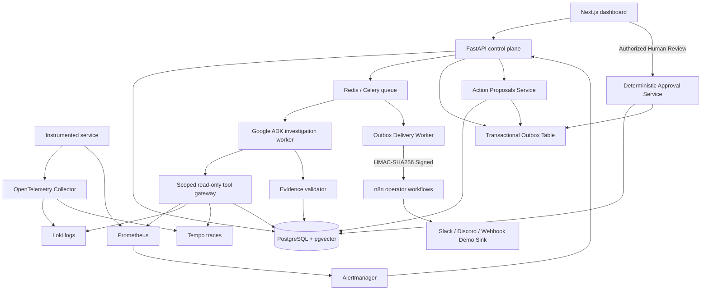

# Architecture — Implementation Baseline

**Status:** `IMPLEMENTED & VERIFIED (Phases 0–6)`  
**Canonical source:** Master implementation plan §§3–5, 7–9, 14, 17.  
**Related decisions:** ADR-001 through ADR-026, DEC-001 through DEC-315 in `ENGINEERING_DECISIONS.md`.

## Responsibility boundaries

- **Data plane:** sample app and third-party telemetry components. No LLM on the ingestion hot path.
- **Control plane:** auth/authorization, services, alerts, incidents, transactional outbox, action proposals, approvals, audit, API contracts.
- **AI plane:** asynchronous bounded Google ADK tool calls, RAG, evidence ledger, schema validation and evaluations.
- **Automation plane:** PostgreSQL transactional outbox + Celery delivery worker + HMAC-SHA256 signed n8n operator workflows; PostgreSQL remains sole source of truth.
- **Remediation governance:** Immutable action proposals, canonical SHA-256 parameter hashing, RBAC gating (`admin`/`owner`), zero execution in Phase 6.
- **Presentation:** Next.js UI for incident feed, runbook knowledge base, outbox delivery monitoring, and proposal review/approval.

## Architectural invariants

1. Access control is server-owned, never delegated to the model.
2. Logs/runbooks are untrusted input; redact sensitive data and resist prompt injection.
3. Diagnosis citations resolve to authorized evidence IDs or the answer is not presented as verified.
4. Model outages cannot stop basic incident ingestion.
5. No production action execution in portfolio v1; staging execution requires explicit policy-checked approvals.
6. Start with one bounded agent; expand only after benchmarks justify complexity.

## Change control

Add/extend an ADR before changing a major boundary. Record all behavior-affecting defaults and smaller decisions using `DEC-XXX` entries. Update this file only after developer-authorized design changes, and update statuses after implementation evidence exists.
